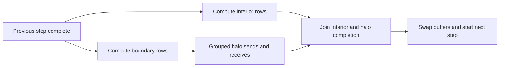

# NCCL groups, overlap, and reusable buffers

Group the sends and receives that need concurrent progress. Then overlap their
execution with work that does not need the received data. These are separate
decisions: batching submissions does not create independent work or prove that
the GPU ran communication and computation together.

The [multi-GPU communication lab](../labs/multi_gpu_communication/README.md)
applies both decisions to one Jacobi workload. Its serialized and overlapped
schedules use the same grid, arithmetic, halo messages, and iteration count.

## Why group communication calls?

`ncclGroupStart()` and `ncclGroupEnd()` collect calls from the current host
thread. They let matching P2P calls make progress together, support a thread
that controls several GPUs, and can amortize submission overhead. Use a group
for a send/receive exchange or a set of neighbor transfers that would otherwise
wait on one another. Keep a single independent transfer simple. A group is not
an MPI communicator or a PyTorch process group.

All participants still need matching peers, counts, and datatypes. Multiple
messages to the same peer in the same direction must match in order. The
issue order of grouped collectives must also agree across ranks, including
operations on different communicators. The
illustrative two-rank exchange below assumes distinct valid send and receive
buffers, a ready producer, and an initialized communicator and CUDA stream.
`NCCL_CHECK` checks the return code.

```cpp
NCCL_CHECK(ncclGroupStart());
NCCL_CHECK(ncclSend(send_buffer, count, ncclFloat, peer, comm, stream));
NCCL_CHECK(ncclRecv(recv_buffer, count, ncclFloat, peer, comm, stream));
NCCL_CHECK(ncclGroupEnd());
```

This follows NVIDIA's [P2P send/receive pattern](https://docs.nvidia.com/deeplearning/nccl/user-guide/docs/usage/p2p.html).
The SC26 tutorial develops the same idea in
[its host NCCL lesson](https://github.com/FZJ-JSC/tutorial-multi-gpu/blob/cd34f9d40d600efd8d84e433b1a9e84ab5eff5f3/07-H_NCCL_NVSHMEM/solutions/NCCL/jacobi.cpp).
For one-to-all communication, sending a different buffer to each rank expresses
a scatter. Use `ncclBroadcast` when every rank needs the same payload.

For the blocking communicators used here, successful `ncclGroupEnd()` means the
operations have been submitted to their streams. It does not mean the GPU has
finished them. Do not synchronize the stream or consume a pending receive
inside an open group. Synchronize or add a completion dependency after closing
it. Nonblocking communicators also require their documented asynchronous
progress/error handling. See the [group API](https://docs.nvidia.com/deeplearning/nccl/user-guide/docs/api/group.html).

Grouping independent small operations can reduce launch overhead. Waiting to
collect a large batch can delay an already-ready transfer. Grouping also does
not combine application payloads into a contiguous tensor. Choose the batch
boundary around one communication phase, then measure its effect. NVIDIA
documents [aggregation and cross-rank ordering](https://docs.nvidia.com/deeplearning/nccl/user-guide/docs/usage/groups.html).

## Overlap boundary exchange with interior work

A decomposed Jacobi step computes its boundary rows before sending them to
neighbors. Interior rows can be computed while those transfers run. The next
step needs both the new interior and the received halos.



Use a communication stream for the boundary producer and the entire NCCL
group. Use a compute stream for the interior. An event makes the previous
iteration's completed input available to the communication stream. After the
group, record halo completion and make the compute stream wait before advancing
to the next iteration. Keeping the producer and its send on one stream supplies
their ordering without a host-wide synchronization.

Do not put unrelated compute and communication streams into the same NCCL
group. NCCL's [multiple-stream semantics](https://docs.nvidia.com/deeplearning/nccl/user-guide/docs/usage/streams.html)
join all streams participating in that group before the communication starts
and prevent them from advancing until it finishes. That can remove the overlap
the application intended.

The lab queries `cudaDeviceGetStreamPriorityRange()` and gives the communication
stream the returned highest priority. Priority is a scheduling hint. It does not
preempt running kernels or replace event dependencies. NCCL kernels can compete
with compute for SMs and memory bandwidth. Splitting the stencil also adds
launches and synchronization. Overlap is most useful when the interior offers
enough independent work to hide a meaningful portion of communication. A single
stream can be sufficient for small partitions or negligible transfer cost.
See CUDA's [stream-priority rules](https://docs.nvidia.com/cuda/cuda-programming-guide/03-advanced/advanced-host-programming.html#stream-priorities).

## PyTorch: submit the exchange as one batch

In PyTorch, use public `P2POp` and `batch_isend_irecv` APIs for the corresponding
NCCL P2P batch. This fragment assumes an initialized NCCL process group, the
correct current CUDA device, ready contiguous tensors, and matching peer calls.

```python
requests = dist.batch_isend_irecv([
    dist.P2POp(dist.isend, send_tensor, peer, group=process_group),
    dist.P2POp(dist.irecv, recv_tensor, peer, group=process_group),
])
# Enqueue work that does not read recv_tensor or overwrite send_tensor here.
for request in requests:
    request.wait()
# Use the receive on the stream that waited for its completion.
```

Keep the tensors alive and preserve the send contents until communication is
complete. If this is the process group's first collective call, every rank
in that group must participate. A consumer on another CUDA stream needs an
explicit dependency. ProcessGroupNCCL manages its own streams, so assigning a
priority to an arbitrary application stream does not configure NCCL's internal
stream priority. See [PyTorch's batch and CUDA completion rules](https://docs.pytorch.org/docs/stable/distributed.html#torch.distributed.batch_isend_irecv).

Existing examples include the
[pipeline neighbor exchange](pipeline_parallel_common.py) and Chapter 13's
[context-parallel K/V exchange](../ch13/context_parallel_benchmark_common.py).
Inspect their waits before claiming they hide communication.

## Register buffers when reuse can repay setup

NCCL may stage data internally. User buffer registration can avoid extra
internal copies on supported algorithms and transports. It does not remove the
network transfer, guarantee a faster step, or mean every unregistered operation
always takes an extra staging path.

For explicit local registration, the lifecycle is allocation, registration,
repeated communication, completion, deregistration, then deallocation. The
following fragment shows one buffer's lifecycle. Register every participating
send and receive allocation, including both ping-pong buffers.

```cpp
void* buffer = nullptr;
void* registration = nullptr;
NCCL_CHECK(ncclMemAlloc(&buffer, bytes));
NCCL_CHECK(ncclCommRegister(comm, buffer, bytes, &registration));
// Submit repeated operations using this allocation.
CUDA_CHECK(cudaStreamSynchronize(stream));
NCCL_CHECK(ncclCommDeregister(comm, registration));
NCCL_CHECK(ncclMemFree(buffer));
```

`bytes` is a byte count. Register once outside steady-state timing. Use the same
registration choice on all ranks and satisfy the requirements for the selected
transport and algorithm. Keep storage and handles alive through the last use.
For captured operations, complete replay and destroy graphs before releasing
their resources. Explicit registration, graph-based registration, and
[device-API symmetric windows](nccl_device_communication.md) have different
contracts. Consult NVIDIA's [registration requirements](https://docs.nvidia.com/deeplearning/nccl/user-guide/docs/usage/bufferreg.html).

Registration adds setup and resource-management work. It is worth investigating
for reusable buffers on supported paths. Ordinary allocations can be enough
for infrequent transfers. Compare registration modes separately from scheduling
modes, and report startup cost alongside steady-state latency.

## Check the mechanism in a retained trace

First verify the complete output for both schedules. Then inspect per-rank
Nsight Systems traces. Look for boundary compute before the grouped exchange,
interior kernels overlapping NCCL kernels or transfers, and the final wait
before input reuse. A larger number of streams or asynchronous API calls is
not evidence of simultaneous execution.

Compare equal grids, ranks, iteration counts, registration choices, and graph
modes. Keep unprofiled timing separate from intrusive profiler timing. Report
whether a trace shows overlap and whether the full step improves. The
[collective diagnosis tool](collective_diagnosis.md) helps distinguish delayed
arrival, contention, and dependencies when a collective remains slow.
