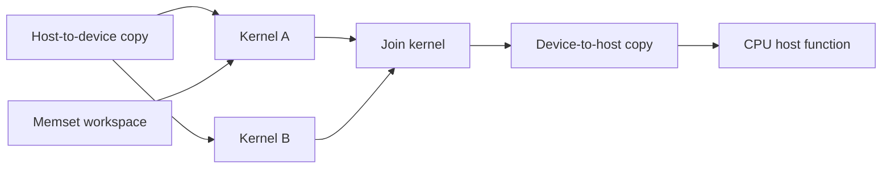

# CUDA Graphs: define, instantiate, and replay

A CUDA Graph describes asynchronous work and the dependencies that make it safe. Reusing that description can reduce repeated host submission work. It also adds setup, resource management, and update constraints. Use it when a repeated schedule gives enough reuse to repay those costs. Keep eager launches when the work changes frequently or submission overhead is already small.

The target is repeated CPU launch, driver, and launch/grid scheduling work around short kernels. Graph replay does not inherently make unchanged kernel arithmetic faster. It can also change gaps and scheduling on the GPU, so inspect both CUDA API activity on the CPU and the actual GPU timeline. Fewer host calls alone do not establish a faster completed workload.

## Describe the work as a DAG

Nodes represent operations. Ordinary dependency edges make a downstream node eligible after its predecessors complete. Independent branches may execute together, but hardware capacity and the selected operations still determine whether they do. A graph is not a list of stream names or a guarantee of overlap.

This conceptual DAG has two independent transforms and a final CPU consumer. It is a teaching diagram, not a captured timeline or the exact implementation of the communication lab. The two transforms need separate output storage.



CUDA supports more than kernel nodes:

| Operation | Meaning and responsibility |
|---|---|
| Kernel | Bind the function, device/context, launch dimensions, arguments, and accessible storage. |
| CPU host function | Execute CPU work after its predecessors. Keep callback data alive through execution. |
| Memcpy and memset | Represent transfers and initialization with valid addresses, sizes, contexts, and dependencies. |
| Allocation and free | Put device-memory lifetime in the DAG. Every use must follow allocation and precede its free. Graph-memory rules restrict valid instantiations and reuse. |
| CUDA event record and wait | Connect CUDA work to an event or express dependencies during capture. Internal captured edges and externally visible events are different choices. |
| External semaphore wait and signal | Connect to correctly imported external synchronization objects. These are not CUDA event handles. |
| Child graph | Embed a subgraph as a node to organize a larger workflow. This is distinct from a device kernel launching another executable graph. |

The [Graph Management API](https://docs.nvidia.com/cuda/cuda-runtime-api/group__CUDART__GRAPH.html) defines these node types and their restrictions. The [graph-memory guide](https://docs.nvidia.com/cuda/cuda-programming-guide/04-special-topics/cuda-graphs.html#graph-memory-nodes) explains allocation lifetimes. Check the installed toolkit before adding a node type to a runnable path.

A CPU host function must not call CUDA APIs. It must also avoid waiting for later CUDA work that cannot run until that function returns. Adding a blocking host function can put the CPU on the critical path. CPU code executed while building or capturing a graph is not automatically replayed as a host-function node. [Host-function contract](https://docs.nvidia.com/cuda/cuda-runtime-api/group__CUDART__EXECUTION.html)

## Separate the three lifecycle stages

**Define a template.** A `cudaGraph_t` describes nodes and edges. Build it explicitly with `cudaGraphCreate` and node/dependency APIs, or capture supported operations between `cudaStreamBeginCapture` and `cudaStreamEndCapture`. Capture records CUDA work rather than executing the captured operations at that moment. It does not record arbitrary CPU control flow or turn every library call into a replayable node.

**Instantiate an executable.** Instantiation validates the template, takes a snapshot, and prepares resources and scheduling information in a `cudaGraphExec_t`. Much of the launch setup is paid here. Explicit upload can move additional first-launch work out of the timed region. An executable can outlive the template used to create it, but application buffers and callback data must remain valid through their actual in-flight uses.

**Execute repeatedly.** Launch the executable into a stream with `cudaGraphLaunch`. Create and instantiate once for a stable schedule, then replay it for new data in valid buffers. Completion is asynchronous to the host. Use the appropriate stream/event completion before reading results or reusing storage. Keep graph-owned memory under its own allocation/free-node rules. [Definition, instantiation, and execution](https://docs.nvidia.com/cuda/cuda-programming-guide/04-special-topics/cuda-graphs.html#building-and-running-graphs)

Separate setup, upload, warmup, replay, and teardown in a measurement. Count extra setup relative to the eager baseline, rather than charging both variants' shared allocation or reference work only to graphs. If graph replay saves time per step, divide the additional setup cost by that saving to estimate the reuse needed to repay it. Normalize a two-step graph to the same number of solver steps as the eager path. If there is no positive per-step saving, this measurement has no break-even reuse count.

The native communication lab currently reports `capture_ms` as one combined setup interval. It includes its MPI setup barrier, capture of the pair and odd-tail templates, and instantiation of both executables. It does not report separate instantiation or upload durations. Do not interpret that aggregate as capture-only time or an unreported phase as zero cost. Its `graph_warmup_ms` includes warmup replays and resets, while steady-state timing covers completed solver steps.

## Capture a fork and join

This illustrative norm-check pattern records work on two streams. It is not extra work performed by the fixed-iteration native lab. Create the streams, events, device scalar, and pinned host readback storage before capture. `CHECK` must stop on an API failure, and the omitted kernels must implement a valid reduction into `norm`.

```cpp
CHECK(cudaStreamBeginCapture(origin, cudaStreamCaptureModeGlobal));
CHECK(cudaMemsetAsync(norm, 0, sizeof(float), origin));
CHECK(cudaEventRecord(reset_done, origin));
CHECK(cudaStreamWaitEvent(branch, reset_done, 0));
launch_boundary_work(branch);
CHECK(cudaEventRecord(boundary_done, branch));
launch_interior_work(origin);
CHECK(cudaStreamWaitEvent(origin, boundary_done, 0));
CHECK(cudaMemcpyAsync(host_norm, norm, sizeof(float),
                      cudaMemcpyDeviceToHost, origin));
CHECK(cudaStreamEndCapture(origin, &graph));
```

The recorded memset, kernels, and copy execute on later graph launch. Event waits express the fork and join without making the CPU wait. Rejoin the branch to the origin stream before ending capture. Do not synchronize captured streams/events, query their execution completion, or synchronize the device during capture. Capture introspection APIs have a separate contract. `cudaStreamCaptureModeGlobal` controls capture-safety checks across host threads. It does not capture all MPI ranks or every GPU automatically. [Capture and prohibited operations](https://docs.nvidia.com/cuda/cuda-programming-guide/04-special-topics/cuda-graphs.html#stream-capture)

A host `std::swap(a, b)` during construction changes the arguments used by later captured launches. It does not change addresses already recorded in earlier nodes, and the swap itself is not replayed as a node. This is why a ping-pong schedule needs matching pointer bindings in its captured steps or graph variants.

## Choose instantiation flags and keep diagnostics

The native lab uses `cudaGraphInstantiateWithFlags(exec_out, graph, flags)` with `cudaGraphInstantiateFlagUseNodePriority` and requires CUDA 11.7 or newer for that path. Two flags have different jobs:

| Flag | Effect |
|---|---|
| `cudaGraphInstantiateFlagUseNodePriority` | Use kernel-node priorities, copied from stream priorities during capture, instead of the graph launch stream's priority. Priority remains a scheduling hint and does not replace dependencies. |
| `cudaGraphInstantiateFlagAutoFreeOnLaunch` | Before relaunch, free graph allocations left live by an earlier execution. It concerns allocation nodes. It does not clean up ordinary `cudaMalloc` buffers or application resources. |

The five-argument `cudaGraphInstantiate(exec_out, graph, error_node_out, log_buffer, buffer_size)` overload provides an optional error node and diagnostic log. It remains listed in the CUDA 13.0 and current C++ API documentation. The `WithFlags` call above takes flags in its third argument instead. `cudaGraphInstantiateWithParams` provides structured `errNode_out` and `result_out` diagnostics with instantiation parameters. Check the installed headers and the chosen API's return status. Instantiation failure is a hard error, and a failed executable must not be launched. [CUDA 13.0 flags and parameters](https://docs.nvidia.com/cuda/archive/13.0.0/cuda-runtime-api/group__CUDART__GRAPH.html), [current C++ overload and diagnostics](https://docs.nvidia.com/cuda/cuda-runtime-api/group__CUDART__HIGHLEVEL.html)

## Streams, dependencies, and concurrent launches

Launching a graph into one stream orders it with other work in that stream. It does not force the graph's independent internal branches into a serial sequence. The DAG and resource constraints determine internal execution. Conversely, two streams do not let the same executable graph run twice concurrently: launches of one `cudaGraphExec_t` are ordered after its earlier launches, even when submitted to different streams.

Independent executable instances can permit concurrent executions when their buffers, dependencies, and node-type restrictions allow it. Separate instances do not make shared output buffers safe or guarantee hardware overlap. Some graph-memory configurations restrict how many instances can exist. Also serialize access to graph objects from CPU threads as required by the API. [Graph launch and concurrency rules](https://docs.nvidia.com/cuda/cuda-programming-guide/04-special-topics/cuda-graphs.html#using-graph-apis)

During stream capture, CUDA event record/wait operations can fork into another local stream and rejoin the origin stream. Complete that join before ending the capture. For synchronization with work outside the captured graph, explicit event nodes or the appropriate `cudaEventRecordExternal` and `cudaEventWaitExternal` capture flags preserve an external event operation. An external semaphore has a separate import and ownership contract. Neither mechanism automatically creates an MPI-wide graph. [Event capture flags](https://docs.nvidia.com/cuda/cuda-runtime-api/group__CUDART__TYPES.html), [stream capture](https://docs.nvidia.com/cuda/cuda-programming-guide/04-special-topics/cuda-graphs.html#stream-capture)

A supported host-created graph can describe work associated with multiple devices, with contexts, memory access, and dependencies set explicitly. Its launch stream does not move all nodes onto that stream's device. Device-launched graphs have tighter restrictions. A multi-GPU application therefore needs both a valid local CUDA graph and a valid communication protocol.

## Update the executable deliberately

Changing the original template does not automatically change an already instantiated executable. Use a supported executable-node parameter update, a compatible whole-graph update, or instantiate a new executable. Check update status and node-specific restrictions rather than silently continuing with the old schedule. Changing input contents in an existing buffer is different from changing a captured pointer, launch parameter, or topology. [Graph update API](https://docs.nvidia.com/cuda/cuda-runtime-api/group__CUDART__GRAPH.html)

The [parameterized graph lab](../labs/parameterized_cuda_graphs/README.md) gives a concrete example. Its [replay implementation](../labs/parameterized_cuda_graphs/parameterized_cuda_graphs_common.py) retains the template, instantiates it once, finds memcpy nodes, and updates their executable parameters for each request slot. Device buffers, shapes, weights, and graph topology stay fixed. This is not arbitrary dynamic-shape graphing or permission to mutate captured NCCL peers.

## Read the actual implementations

| Repository path | Implemented scope |
|---|---|
| [Standalone graph replay](optimized_cuda_graphs.cu), `main` | Captures a block of single-GPU kernels, instantiates, uploads, warms up, replays, and destroys the graph resources. |
| [Harness CUDA extension](cuda_extensions/cuda_graphs_kernels.cu), `graph_replay` | Caches an executable for the current device, buffer address, element count, and iteration count. It rebuilds when that cache key changes. Its `AutoFreeOnLaunch` flag does not itself create allocation nodes. |
| [Conditional graph construction](optimized_graph_conditional_runtime.cu), `main` | Uses explicit node APIs and device-controlled IF body graphs. A conditional body is not an ordinary child-graph node or a CPU host callback. |
| [Graph bandwidth example](optimized_graph_bandwidth.cu), `main` | Captures the kernel sequence. The shown `cudaMalloc`, input copies, and memset occur before capture and therefore are not graph allocation, memcpy, or memset nodes. |
| [Parameterized replay](../labs/parameterized_cuda_graphs/parameterized_cuda_graphs_common.py), `ParameterizedGraphReplayBenchmark` | Captures copies and PyTorch work, then changes supported executable memcpy bindings before replay. |
| [Native halo exchange](../labs/multi_gpu_communication/jacobi_native.cu), `NativeJacobi::capture` | Captures two solver steps across local compute/communication streams and creates a separate odd-tail executable. Each MPI rank owns its own graph and GPU. |

These paths cover kernel capture, explicit conditional construction, parameterized copies, and local cross-stream dependencies. They do not provide runnable examples of CPU host-function nodes, graph-owned allocation/free nodes, external semaphore integration, or ordinary child-graph hierarchy. Those node families are explained above as CUDA capabilities, not certified repository implementations. Reuse the mapped examples before adding another graph benchmark.

## Keep the communication graph rank-local

In the [communication lab](../labs/multi_gpu_communication/README.md), one pair graph executes A → B → A. Repeating it preserves the next input's buffer orientation. A separate A → B tail handles an odd step count, and final readback selects the buffer for the number of completed steps. These are two executable graphs, not a parent graph with a child-graph node.

The MPI barrier around setup is outside capture. Captured CUDA events connect the two streams in the same process. Captured NCCL work still requires matching capture/replay participation by its peers. No single `cudaGraph_t` represents all MPI ranks. The lab supports capture for NCCL and explicitly rejects graph requests for its MPI and NVSHMEM backends. A host callback cannot turn those rejected paths into a supported global graph. [NCCL capture requirements](https://docs.nvidia.com/deeplearning/nccl/user-guide/docs/usage/cudagraph.html)

If adding convergence checks, make the norm-check path and the decision to continue agree across ranks. A captured scalar argument or pointer stays at its captured value unless deliberately updated. Choose appropriate graph variants or a supported device-control mechanism, then validate odd/even counts, complete outputs, and buffer lifetimes. Follow the [targeted exercises](../labs/multi_gpu_communication/TASKS.md#5-capture-a-stable-schedule) before extending the native path.

In a host-controlled convergence loop, a norm-check graph can include device-to-host norm readback, followed by stream completion and a host `MPI_Allreduce`. The CUDA graph does not capture that host reduction. Without completion, ordinary MPI cannot safely read an asynchronously produced host norm. Frequent norm synchronization and reductions can remove the overlap or launch savings being measured. A parity-selected `exec[iteration % 2]` must also select the appropriate norm/no-norm variant. The current native solver uses fixed steps and a pair graph plus odd tail instead of this convergence loop.

## Distinguish a DOT graph from measured execution

`cudaGraphDebugDotPrint(graph, path, flags)` exports template structure. An optional debug export belongs after successful capture and before destroying the template, with separate filenames for each rank and pair/tail variant. The current native lab has no DOT-export CLI flag. Graphviz can render an exported file with `dot -Tsvg graph.dot -o graph.svg`. [CUDA DOT export](https://docs.nvidia.com/cuda/cuda-runtime-api/group__CUDART__GRAPH.html)

DOT nodes and arrows show operations and declared dependencies. Their positions and widths do not measure kernel duration or prove simultaneous execution. Use retained Nsight Systems captures to check CPU submission gaps, GPU intervals, and the expected join. For per-node graph inspection, select supported node-level graph tracing, such as `--cuda-graph-trace=node`, and label it separately from graph-level tracing. Keep capture, instantiation, upload, warmup, replay, norm checks, and cleanup in distinct evidence ranges where present.
