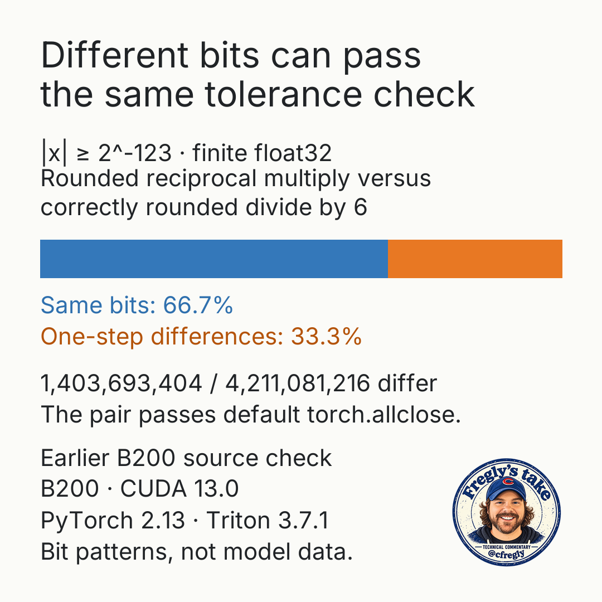

# Division by six: choose the numerical contract

My advice: before replacing division with a stored reciprocal, decide whether the optimized kernel must match the reference bit for bit, stay within a justified error bound, or meet a downstream quality target. Matching bits can require precise arithmetic, which can cost throughput. A tolerance accepts different outputs, so the application owner must justify that error.



The B200 source records dated October 24, 2026 show a useful distinction: **33.3% of this input-bit census differs by one step**, while the recorded reciprocal-multiply tolerance comparison passed. A uniform bit census is not a model's value distribution, and these counts do not establish a speedup or task quality.

Start with the [lab's methods and setup](code/README.md). The maintained lab separates CUDA and Triton numerical comparisons, a hardsigmoid example, and optional component timing. Its maintained bytes did not produce the historical counts, and no fresh GPU result is claimed here.

Use the [numerical census](evidence/numerical-census.md) for the exact cohort, two source records and computed percentages. The [machine-readable counts](evidence/numerical-census.json), [source index](evidence/source-index.json) and [provenance](evidence/provenance.json) keep the reference and source identity explicit.

The related starting point is Gimlet Labs' [Formally Verifying AI-Generated GPU Kernels](https://gimletlabs.ai/blog/formally-verifying-ai-generated-kernels), by Jubi Taneja, Tom St John and Natalie Serrino. Its exact-real representation limit is a reason to state floating-point behavior separately from algebraic equivalence. Pair formal reasoning with numerical checks that match the application's actual contract.

## Try the derivation first

The pure derivation tests need Python 3.11 or newer and pytest 8 or newer. They do not need a GPU, PyTorch, Triton or NumPy. From this companion's directory:

```bash
cd code
PYTHONPATH=src python -m pytest -q tests/test_derivation.py
```

For CUDA checks, use an already prepared Linux environment with CUDA-enabled PyTorch, Triton, NumPy, a compatible NVIDIA GPU with multiple GiB free, a host C++ compiler, and `nvcc`, `cuobjdump` and `nvidia-smi` on PATH. The Triton and hardsigmoid checks use fixed `2^27`-element chunks. Compatibility with small GPUs has not been established.

The [lab guide](code/README.md) describes the stages and their failure paths. Its `--quick` mode still runs the CUDA count in full and samples two chunks for the Triton and hardsigmoid checks. Use `--skip timing,ncu` when you want correctness checks without timing or profiling. An unavailable CUDA device exits with an error. Use a new result name for each run. By default, named runs are stored under `$XDG_STATE_HOME/divide-not-reciprocal/runs`, with `~/.local/state` as the fallback. `--results` selects another parent directory.
