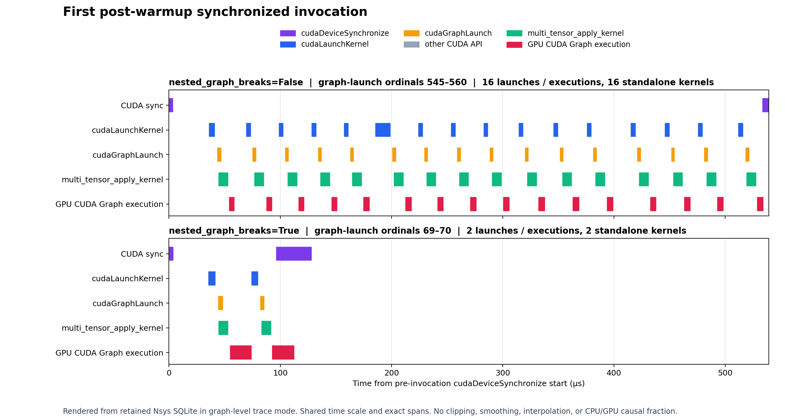
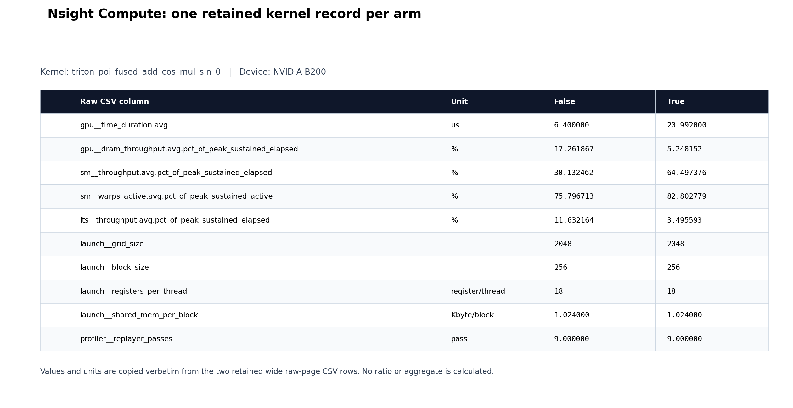

# Download the actual profiler captures

These are retained profiler files, not graph diagrams or reconstructed
measurements. The native Nsight reports, SQLite databases, CSV exports, and
Chrome traces below preserve their recorded bytes. Open the native reports in
the matching NVIDIA desktop tool. GitHub's **Download raw file** action saves
the original report.

The executed workload is in [benchmark.py](../benchmark.py), with the original
[capture helper](../profile_capture.py) and [analyzer](../analyze.py).

## Views of the retained profiles





These views render the retained Nsys SQLite and NCU CSV values. They are not
native GUI screenshots. Download the reports below to inspect them in Nsight.
The [renderer](render_profile_views.py), [tests](test_render_profile_views.py),
and [view manifest](views/profile-view-manifest.json) are retained beside them.

The Nsys window is the first synchronized latency invocation after 25 warmup
calls, compiled call 36 under the source protocol. It uses graph-launch
ordinals 545–560 for False and 69–70 for True, with synchronization boundaries
and exact one-to-one graph-execution correlations checked. Both panels share
one time scale. It is a fixed excerpt, not a new latency acceptance result.

This capture uses graph-level tracing. GPU CUDA Graph execution spans come
from `CUPTI_ACTIVITY_KIND_GRAPH_TRACE`. Standalone `multi_tensor_apply_kernel`
activity is shown separately. Internal graph-node kernel timelines are not
present in this tracing mode and are not reconstructed.

To reproduce the views with Python and Matplotlib already available, create
an empty output directory and run from this directory:

```bash
python render_profile_views.py \
  --false-sqlite fresh022/exports/nsys-baseline.sqlite \
  --true-sqlite fresh022/exports/nsys-candidate.sqlite \
  --false-ncu-csv fresh022/exports/ncu-baseline-raw.csv \
  --true-ncu-csv fresh022/exports/ncu-candidate-raw.csv \
  --transport-manifest fresh022/manifest.json \
  --output-dir /absolute/empty-output-directory
python -m unittest test_captures test_render_profile_views
```

The source checks use synthetic fixtures and file hashes. They do not run the
workload, capture another profile, or change the native reports.

## Native Nsight files: successful fresh run 022

Both arms ran the depth-8, seed-0 workload on NVIDIA B200 with PyTorch
2.14.1+cu130. False is the baseline. True is the candidate. These captures
belong to independent fresh run 022, not the older cohort behind the original
4.53× post and not the later no-CUDA-Graph diagnostic.

| Tool | Flag False | Flag True |
| --- | --- | --- |
| Nsight Systems 2026.5.1 | [baseline .nsys-rep](fresh022/native/nsys/nsys-nested_break_depth8-seed0-baseline.nsys-rep) | [candidate .nsys-rep](fresh022/native/nsys/nsys-nested_break_depth8-seed0-candidate.nsys-rep) |
| Nsight Compute 2026.2.1 | [baseline .ncu-rep](fresh022/native/ncu/ncu-nested_break_depth8-seed0-baseline.ncu-rep) | [candidate .ncu-rep](fresh022/native/ncu/ncu-nested_break_depth8-seed0-candidate.ncu-rep) |

The Nsys files are 3,423,394 and 2,235,130 bytes. The NCU files are 71,075 and
235,706 bytes. All four fit directly in Git. They were copied from the retained
archive without rerunning or recapturing the workload.

## Existing exports and trace files

- Nsight timeline databases: [False](fresh022/exports/nsys-baseline.sqlite), [True](fresh022/exports/nsys-candidate.sqlite).
- Nsight CUDA API summaries: [False CSV](fresh022/exports/nsys-baseline_cuda_api_sum.csv), [True CSV](fresh022/exports/nsys-candidate_cuda_api_sum.csv).
- Nsight kernel summaries: [False CSV](fresh022/exports/nsys-baseline_cuda_gpu_kern_sum.csv), [True CSV](fresh022/exports/nsys-candidate_cuda_gpu_kern_sum.csv).
- NCU raw-page metrics: [False CSV](fresh022/exports/ncu-baseline-raw.csv), [True CSV](fresh022/exports/ncu-candidate-raw.csv).
- Same-run PyTorch Chrome traces: [False](fresh022/timing-seed0/nested_break_depth8-seed0-flag0/profile.chrome.json), [True](fresh022/timing-seed0/nested_break_depth8-seed0-flag1/profile.chrome.json).
- Older historical-002 Chrome traces: [False](historical002/flag0.chrome.json), [True](historical002/flag1.chrome.json). These remain a separate cohort.

The Chrome JSON files can be opened in a compatible trace viewer. They are
PyTorch traces, not Zymtrace captures. No Zymtrace capture or import was retained
for this experiment. Zymtrace integration is deferred.

The later diagnostic's four raw Chrome traces are also retained separately:
[original False](followup/original/flag0/profile.chrome.json),
[original True](followup/original/flag1/profile.chrome.json),
[no-CUDA-Graph False](followup/no-cudagraph/flag0/profile.chrome.json), and
[no-CUDA-Graph True](followup/no-cudagraph/flag1/profile.chrome.json).
Their [manifest](followup/manifest.json) preserves exact hashes.
The [corrected profile outputs](followup/corrected/) retain all invocation
records and candidate exclusions 3, 4, and 5. Those diagnostic traces are not
the scientific run-022 Nsight reports.

## What the native captures show

The whole Nsys captures contain 10,160 versus 1,270 `cudaGraphLaunch` calls and
12,167 versus 2,639 kernel instances. Those totals include setup and other
phases. They are not counts for one synchronized steady invocation.

NCU recorded one matching fused Triton kernel per arm. Its saved duration is
6.400000 us for False and 20.992000 us for True. The larger fused kernel does
more work per launch. These individual-kernel durations are not whole-call
speedups. The raw CSV retains all metrics and units, including the five
strictly validated metrics. The unprofiled timing workers establish the
experiment's latency result.

CPU submission, GPU execution, synchronization, and overlap do not form
independent causal shares. Neither these reports nor the no-replay ablation
establishes an exact CPU/GPU causal percentage.

## Provenance and preservation

[manifest.json](fresh022/manifest.json) records every file's byte count,
SHA-256, and source archive member. The original archive SHA-256 is
`f5fedbbed86caade3786b7be0a425c9ed2338a61e30292a73b6027d2862f03cb`.
Raw reports retain tool-recorded metadata, including absolute runtime/source
paths and process/device information.

The accepted identity chain is:

1. Actual run-022 controller child artifacts.
2. [Executed offline export receipt](fresh022/exports/offline-profiler-export-result.json), SHA-256 `579f69ff51fd11cdf05b7121e97dbcd0305012f7abb9ab84b2ae1e858d1592a0`.
3. [Strict profiler qualification](fresh022/qualification/STRICT-PROFILER-QUALIFICATION.json), SHA-256 `6c2ec3215b144b06f771e0dfa2e2b90898c0c7744c0504e57d3a9c1a399fc538`.
4. [Final scientific qualification](fresh022/qualification/FINAL-SCIENTIFIC-QUALIFICATION.json), SHA-256 `0b836a908264d2592d3a79eb7ff304bf0bc9b0d9031f4ccf7627577ce9844a3a`.

The frozen export recipe contained older literal capture hashes. The executed
receipt explicitly binds the actual run-022 child artifacts instead. The
native files here match that executed receipt and the accepted strict/final
chain. The recipe literals are not used to identify these captures.

No original benchmark result or capture was overwritten. Raw reports, exports,
worker records, and their successful qualification remain distinct from later
visualizations and diagnostics.
