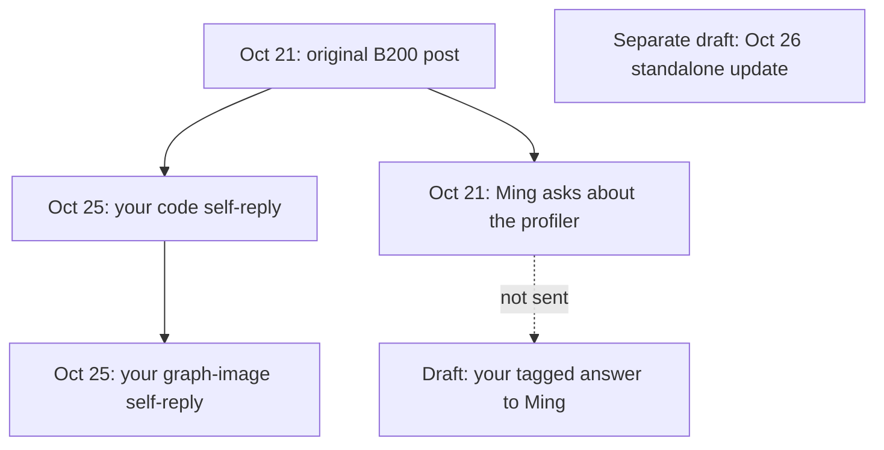

# Where each B200 post and reply belongs

As of October 26, 2026. All dates and times below use America/Los_Angeles.
Typefully remains the drafting hub. Nothing in the new batch has been sent,
scheduled, or published.

The four LinkedIn items formerly named “question reply” were post drafts
holding reply copy. They were not executable replies to those comments.
They are now labeled **LI REPLY COPY … NOT A POST**, with the recipient and
purpose in the title. Their real person-tagged replies are prepared in the
native LinkedIn discussion, with one image each. Do not click Typefully
Publish on those copy banks.

## X: what is already live

| Date | Item | What it replies to |
| --- | --- | --- |
| Oct 21 | [Original six-part B200 thread](https://x.com/cfregly/status/2113125661162496389) | The first post is the root. Its continuations form your own thread. |
| Oct 21 | [Ming’s profiler question](https://x.com/ming85GG/status/2113141199733453183) | Your original root post. The current native view still shows zero public replies to Ming. |
| Oct 25, 4:55pm | [Your code/evidence self-reply](https://x.com/cfregly/status/2114506248158953932) | Your original root post, not Ming’s question. |
| Oct 25, 8:30pm | [Your graph-image follow-up](https://x.com/cfregly/status/2114560342550524196) | Your code/evidence self-reply. This is the older structural diagram, not the new Zymtrace capture view. |

The two Sunday posts were self-replies. They did not answer Ming directly.
The new answer to Ming is a separate unscheduled draft.

## LinkedIn: what is already live

The [original Oct 21 post](https://www.linkedin.com/feed/update/urn:li:ugcPost:7518891357956907008/)
has your startup-cost self-comment and a later pinned code/evidence
self-comment. The pinned comment is verified live. The empty Typefully item
called **REFERENCE ONLY · LinkedIn source comment already live** is only a
saved reference, not proof of publication or another comment to send.

A post’s **Comment** control creates a top-level comment. **Reply** beneath a
particular reader’s comment creates the answer in that reader’s branch.
Adding a name alone does not establish that parent relationship.

| Reader | Topic | Current prepared state | Typefully backup |
| --- | --- | --- | --- |
| Abhik Sarkar | Is the result B200-specific? | Native Reply to his exact comment, real person mention, one profile image, unsent | [Copy bank](https://typefully.com/?a=337207&d=11481014) |
| Devayush Rout | Compilation break-even | Native Reply to his exact comment, real person mention, one profile image, unsent | [Copy bank](https://typefully.com/?a=337207&d=11481015) |
| Abbas Ali Aloc | Memory footprint | Native Reply to his exact comment, real person mention, one profile image, unsent | [Copy bank](https://typefully.com/?a=337207&d=11481016) |
| Fuad Munzerin H. | Training/defaults assertion | Native Reply to his exact comment, real person mention, one profile image, unsent | [Copy bank](https://typefully.com/?a=337207&d=11481017) |

Keep the prepared LinkedIn tab open. Native comment composers may not survive
reload. The concise text is backed up in Typefully and in
[native-linkedin-replies/](native-linkedin-replies/). The native photo chooser
accepts one image per reply. Each answer also links the code, captures, and
committed image in the repository.

A newer comment from [Enéias Brum](https://www.linkedin.com/in/eneiasbrumjr/)
raises service readiness and cold compilation. A [candidate answer](native-linkedin-replies/readiness-candidate.txt)
is retained for later review. It has not been added as another Typefully item
or sent.

## The new standalone update is a different item

[NEW UPDATE · Oct 26 Zymtrace · Standalone X + LinkedIn](https://typefully.com/?a=337207&d=11497664)
is an unpublished standalone update. It does not reply to any one person and
does not replace the Oct 21 posts. Its X version is a short thread and its
LinkedIn version is a post. It credits the verified accounts **@zymtrace** and
**@verdacloud** on X, and the resolved zymtrace and Verda company mentions on
LinkedIn. These credits identify the profiler and B200 provider.

[MING REPLY · X · Profiler question · UNSCHEDULED](https://typefully.com/?a=337207&d=11481018)
is the direct answer to **@ming85GG**, with the actual question as its reply
target. The person’s handle is in the text and the image tag is retained.

## Why the order looked confusing

- Typefully orders drafts by edits. Editing an older draft can move it above a newer one. An updated draft is not a newly published post.
- X threads contain self-replies, and older posts can reappear through reposts or Auto-Retweet. Their original publication date stays the same.
- LinkedIn’s pinned comment stays above other comments. “Most relevant” is not chronological and can hide comments. The prepared discussion is now shown using “Most recent.”
- The repository directory date, October 22, is not the original publication date. Both original platform posts display October 21.

A reply, a text mention, a photo tag, and a repost are different actions.
A **reply** binds a parent. A **mention** names an account. A **photo tag**
associates an account with the image. A **repost** resurfaces an existing post,
while a **quote** adds your commentary to a shared post. A valid tag does not
prove that a notification was delivered or read.

## Typefully and other tools

Typefully currently supports LinkedIn person mentions only for accounts
connected to Typefully or accessible teams. Its post drafts do not bind these
four external reader comments as reply parents. Company mentions work here.
That is why the exact personal replies are prepared natively. See
[Typefully’s mention documentation](https://support.typefully.com/en/articles/13974129-how-to-mention-companies-and-people-on-linkedin).

This is not a blanket LinkedIn ban on third-party replies. Approved integrations
can use [LinkedIn’s Comments API](https://learn.microsoft.com/en-us/linkedin/marketing/community-management/shares/comments-api?view=li-lms-2026-06), subject to permission and product support.
[Buffer Community supports replies on personal LinkedIn profiles](https://support.buffer.com/en-us/articles/how-comments-work-across-each-social-network-in-buffer-community-2IEzkHcO0Q),
but the requested person-tagging workflow is not fully verified as a replacement.
We are keeping Typefully and native LinkedIn. No integration was installed,
connected, or purchased.

## Repeat this check before the next handoff

1. Record each item’s platform, published/draft state, real parent, recipient, and topic.
2. Verify the account from the actual comment and profile. Select a native mention, not plain name text.
3. Label standalone updates, direct replies, copy banks, and live references distinctly.
4. Preserve text, media, parent, unrelated tags, and draft state across edits.
5. Reload and check the final target, rendered mentions, media, and dormant promotion settings. Never equate a lifecycle tag with a person mention.
6. Keep exact draft backups. Do not send, schedule, or edit public posts without publication authorization.

The [conversation ledger](conversation-ledger.json) records identities and
parent IDs. The [current snapshot](current-conversation-snapshot.json) records
exact Typefully text and media for this audit. Existing benchmark files and
older draft snapshots are preserved.

## October 26 image correction, still unsent

The current Typefully items and native LinkedIn replies use the corrected
[GPU-time flamegraphs](../zymtrace/views/). Width is each worker's share of
captured GPU time, normalized independently to 100%. The previous record-count
images remain in the repository as superseded capture diagnostics. Reply
parents and person tags are unchanged. No new post or reply was sent.
