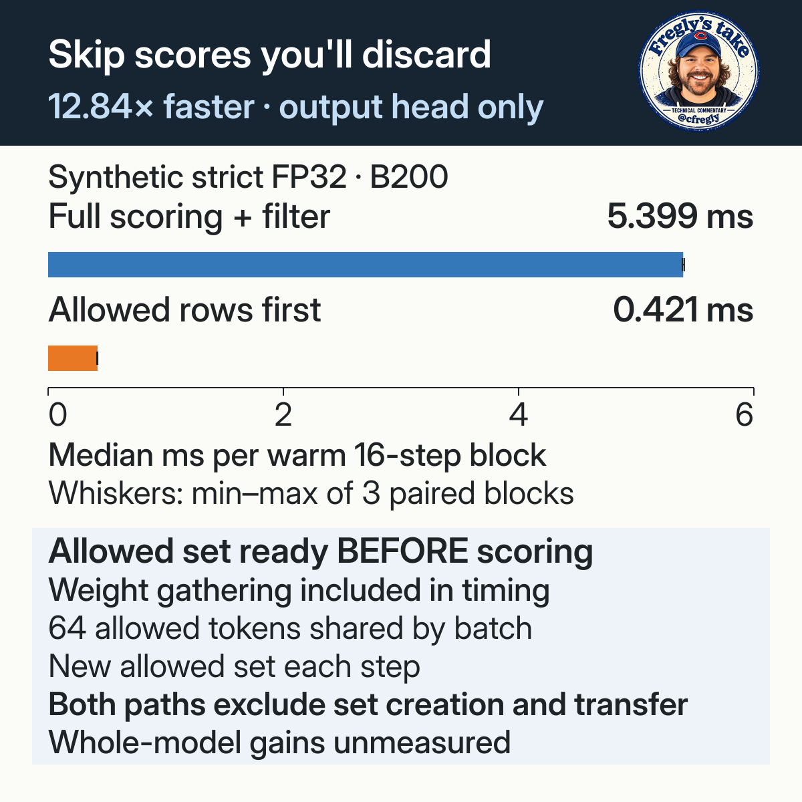
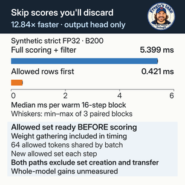
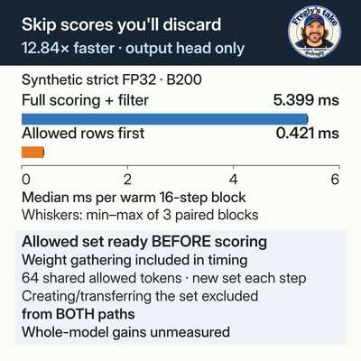
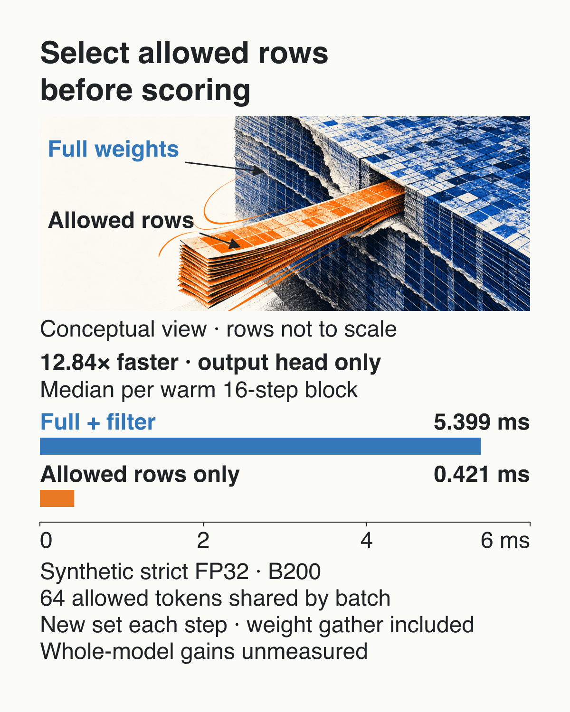

# Score only the choices that are allowed

Suppose a router may answer only A, B or C. Why score the rest? I reproduced the [row selection Murali Manohar described](https://gitlostmurali.com/blog/structured-generation-optimizations/): gather the allowed tokens' weights first, then score them.

The catch is that the allowed set must be ready before scoring. The usual path needs it only when filtering scores afterward. Creating and transferring the set were excluded from both timed paths. My advice: keep full scoring if earlier selection and weight gathering erase the saving, or if the caller needs every token's score.

A token ID is the model's numeric label for a token and its output-weight row. Allowed token IDs identify the tokens the app permits at the next step.

A synthetic output-head benchmark compares two ways to return allowed token scores and their greedy winner. The dense baseline computes `H @ W.T`, gathers the allowed scores, and selects their maximum. The candidate gathers allowed weight rows first, computes `H @ W[S, :].T`, and uses the same selection path.

One NVIDIA B200 ran strict FP32 with TF32 disabled, batch 8, hidden width 2,048 and vocabulary 131,072. Each step shared one sorted, noncontiguous allowed set across all batch rows. A changing set differed at each of 16 steps. The sequence was reused across warmup and timing.

| Allowed IDs | Set behavior | Dense ms/block | Selected rows ms/block | Observed speedup | Setup ms |
|---:|---|---:|---:|---:|---:|
| 16 | Static | 5.489 | 0.334 | 16.43× | 0.035 |
| 16 | Changing | 5.494 | 0.560 | 9.81× | 0.015 |
| 64 | Static | 5.409 | 0.349 | 15.48× | 3.252 |
| 64 | Changing | 5.399 | 0.421 | 12.84× | 0.004 |
| 256 | Static | 5.466 | 0.350 | 15.64× | 0.022 |
| 256 | Changing | 5.471 | 0.421 | 12.99× | 0.004 |

Speedups are ratios of the unrounded median block times.

Times are medians of three matched warm blocks, each containing 16 projection/filter/selection steps and final device synchronization. Pair order was dense-first, candidate-first, then dense-first after two warmup blocks per path. Every one of the 18 pairs favored selected rows. The nearest-rank p95 of three samples is the largest block, rather than request tail latency. Because the fixed rule also requires every paired candidate block to beat its matching baseline, the extra 2% p95 allowance cannot reject a case that has already passed that stricter rule. The fixed order and three pairs do not separate execution order from sample position. In the 64-ID changing-set cell, the candidate-first block took 0.414593 ms, versus 0.420575 and 0.421094 ms for its two candidate-second blocks. In all six cells, the candidate-first block was the fastest candidate block. The largest gap was at 16 changing IDs: 0.476 ms, versus 0.560 and 0.563 ms. Every reported candidate median therefore comes from a candidate-second block. These retained samples support this within-process screen, rather than a broad repeatability claim.

The changing-set timings are not monotonic in set size. I did not profile their cause, so the three sizes establish no scaling trend.

Static mode gathers rows once before warmup and timing. Its setup cost is outside the warm-block ratios above. The retained 64-ID setup interval took 3.252 ms. That interval is far above the 16- and 256-ID intervals. Its cause was not isolated, so it may include a one-time effect rather than gather cost. Changing mode gathers rows in every timed step. Its setup column records synchronization around an empty setup branch. This test did not measure a continuous first-use interval or an observed payback point.

Both paths checked 86,016 allowed logits against an FP64 reference with `rtol=1e-4` and `atol=1e-5`. Maximum absolute errors were approximately `2.44e-6` for dense and `1.01e-6` for selected rows. All 768 selected-token rows per path matched the reference argmax. All-equal and two-way-maximum fixtures chose the smallest allowed ID. These checks cover the tested inputs and explicit ties. Trained-model near-ties need separate validation.

- [Runnable source and reproduction commands](code/README.md)
- [All six results and paired samples](evidence/recomputed-results.json)
- [Original raw timing, allowed IDs and correctness records](evidence/raw.jsonl)
- [Native worker summary](evidence/worker_result.json)
- [Correctness records](evidence/correctness.json) and [timing method](evidence/timing-mode.json)
- [Recorded environment](evidence/environment.json), [measurement metadata](evidence/measurement.json) and [file hashes](evidence/hashes.json)

Recompute and test the retained evidence without a GPU from this directory:

```sh
python3 code/analyze.py
python3 -m unittest discover -s code -p 'test_analyze.py' -v
python3 code/screen.py --self-check
```

The baseline is eager PyTorch CUDA `torch.mm` with preallocated buffers. The observations cover this synthetic stage and input shape. Model computation, grammar transitions, tokenization, sorting and transferring allowed IDs, request scheduling, independent request grammars, other precisions, quantized or sharded heads and end-to-end generation were outside the timing. No profiler capture or measured memory peak is included.

API contracts: [PyTorch matrix product](https://docs.pytorch.org/docs/2.14/generated/torch.mm.html), [linear projection](https://docs.pytorch.org/docs/2.14/generated/torch.nn.functional.linear.html). The [vLLM structured-output interface](https://docs.vllm.ai/en/latest/features/structured_outputs/) provides integration context. This test did not run vLLM.

## Trade-offs

- Both paths need the allowed set. Selecting weight rows needs it before projection and gathers those weights first. Dense scoring needs the set when filtering its scores afterward. This test starts with sorted, device-resident IDs and excludes grammar/tokenizer work, ID production and transfer from both paths.
- Changing-set weight gathering is additional work and is included in its timings. Static reuse pays separate setup outside warm ratios, including the retained 3.252 ms interval at 64 IDs. Cold-start benefit and break-even were not measured.
- All batch rows shared one allowed set. Different sets per request, near-full-vocabulary sets and other precisions remain untested here.
- Both tested paths return allowed scores and their greedy winner under the same output contract. Use full scoring when the caller needs every vocabulary score or full-vocabulary probabilities. The full weight tensor remains resident. No memory saving or complete-request gain is established.

## Prior work

[Underpinning study by Murali Manohar](https://gitlostmurali.com/blog/structured-generation-optimizations/) explains allowed-token weight slicing and batching limitations. The [GSP working paper](https://github.com/StealthEyeLLC/grammar-sparse-projection/blob/30a9d0ed82f26dc53ec74b4f0985e1d213a18625/paper/draft.md) develops packed-mask projection, heterogeneous batching and an end-to-end evaluation. Those authors' results are separate from this controlled B200 reproduction. The core mechanism is established.

## Measured output-head comparison

The figure uses the same changing-set case and methods above. The allowed set
must be available before scoring. Gathering its weights is included in the
reported time. Creating and transferring that set are excluded from both paths.



Rebuild the exact editable chart from the retained summary and paired samples:

```sh
python3 images/gamma-evidence/render_evidence.py --check
```

This checks SVG, PNG, text and preview bytes in temporary storage. Use
`--overwrite` to intentionally regenerate this figure, or
`--output-root /tmp/candidate-output-head-chart` to render a separate copy.
Existing Python 3 with Pillow, librsvg (`rsvg-convert`) and Fontconfig (`fc-match`)
are required. The renderer resolves the packaged regular Inter font and retains
the original upright Fregly's take stamp. No network or GPU work is performed.

Exact PNG checks for the current comparison and cover variants used Python 3.12.2
and Pillow 11.3.0. PNG encoding can differ between Pillow versions even when
the decoded pixels are identical.

The tested raster stack is rsvg-convert 2.62.3, Cairo 1.18.4, Pango 1.57.1,
HarfBuzz 14.2.1 and Fontconfig 2.18.1, with `PANGOCAIRO_BACKEND=fc`. A different
stack may change PNG bytes. Inspect the editable SVG and source data when
reproducing on another stack.

The landscape and square cover variants present the same comparison and
conditions, with a deliberate layout for each aspect ratio. Check them with:

```sh
python3 images/render_data_covers.py --check
```

Use `--output-root /tmp/candidate-data-covers` to render a separate set of cover
variants. This renderer uses the same retained data, evidence renderer, Inter
font and upright stamp.

## Rebuild the explanatory figures

The [figure renderer](images/render_illustrations.py) uses the paired samples and summary above. It needs Python 3 with Pillow, librsvg (`rsvg-convert`) and Fontconfig (`fc-match`), plus the packaged Inter font and [visual tokens](images/visual-tokens.json).

Render to a separate directory for inspection:

```sh
python3 images/render_illustrations.py --public-layout --output-root /tmp/candidate-plain-graphics
```

Omit `--output-root` to replace the canonical figures. The command writes the ten landscape/square figure families and their previews, text and export metadata. If it fails, the chosen output directory may contain partial output. Resolve the reported source, font or layout error before using those figures. It does not run the benchmark or recompute the measurements.

The explanatory figures were produced with Python 3.12.14 and Pillow 12.3.0. The comparison and cover variants above used Python 3.12.2 and Pillow 11.3.0. Both use the librsvg, Cairo, Pango, HarfBuzz and Fontconfig stack listed above, `PANGOCAIRO_BACKEND=fc` and the packaged regular Inter face. Different stacks may produce different PNG bytes.

## Figures

### Output-head comparison and tradeoff


<details>
<summary>Square version</summary>


</details>

### Select allowed rows before scoring


<details>
<summary>Square version</summary>


</details>

### Six warm-block comparisons


<details>
<summary>Square version</summary>


</details>

### Know which tokens are allowed before scoring?


<details>
<summary>Square version</summary>


</details>

### Why score tokens you cannot emit?


<details>
<summary>Square version</summary>


</details>

### Select weights, then score


<details>
<summary>Square version</summary>


</details>

### Include gathering in timing


<details>
<summary>Square version</summary>


</details>

### Reduce the output dimension


<details>
<summary>Square version</summary>


</details>

### Does the batch share one set?


<details>
<summary>Square version</summary>


</details>

### Measure requests before promising capacity


<details>
<summary>Square version</summary>


</details>

### Compare the complete output-head stage


<details>
<summary>Square version</summary>


</details>

<details>
<summary>Renderer resources and earlier comparison</summary>

The chart previews and upright stamp are retained so the renderer can check
its complete output and resolve the same image resource.






The earlier comparison and row-selection artwork support the retained
result-scene renderer. They use the same synthetic FP32 output-head
measurements and scope described above.

The code gathers only the allowed vocabulary rows. Their token IDs do not have to be adjacent.




</details>
